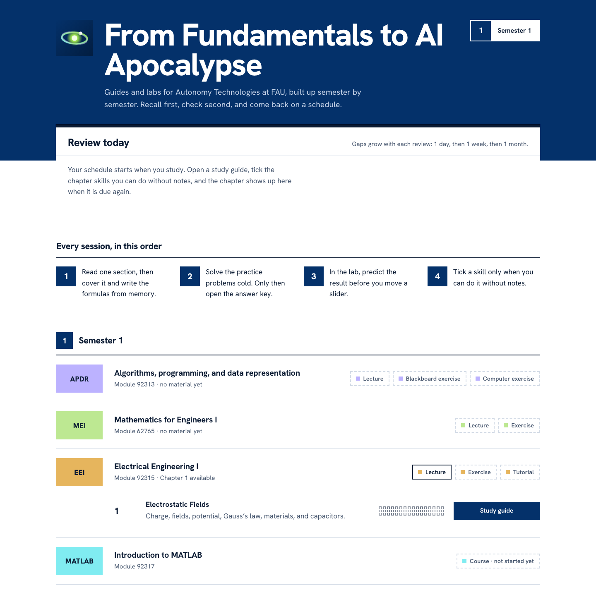

# From Fundamentals to AI Apocalypse

Study guides and interactive labs for the Autonomy Technologies programme at FAU Erlangen-Nürnberg, built up semester by semester for the whole degree.

**[Open the site →](https://unknown-x0.github.io/AutonomyTechnologies/)**



> Personal study material written from the lecture notes. Not an official FAU publication; check anything exam-relevant against your course materials.

## What's inside

The home page has one section per semester. Each subject shows its module number, its course parts and, once they exist, its chapters with a study guide and a lab.

| Semester | Code | Subject | Module | Course parts | Material |
| --- | --- | --- | --- | --- | --- |
| 1 | APDR | Algorithms, programming, and data representation | 92313 | Lecture, blackboard exercise, computer exercise | none yet |
| 1 | MEI | Mathematics for Engineers I | 62765 | Lecture, exercise | none yet |
| 1 | EEI | Electrical Engineering I | 92315 | Lecture, exercise, tutorial | Chapter 1: Electrostatic Fields guide, PDF and LaTeX source |
| 1 | MATLAB | Introduction to MATLAB | 92317 | Course (not started yet) | none yet |

The earlier Electrical Engineering and Mathematics pages were removed on 2026-10-27. The current EEI Chapter 1 guide is a new summary based on the supplied WS 2026/27 lecture notes; the earlier guide and lab remain in git history.

## How to study with it

1. Read one section of a guide, then cover its formulas and write them out from memory.
2. Do the matching practice problems, then open **Show answer key** to check.
3. Try the same idea in the matching lab: change one input and predict the result before you look.
4. Tick the exam checklist as each skill sticks, or press **Log today's review** under the checklist. Ticks and review days are saved in your browser.
5. Start each session on the home page: **Review today** lists every chapter you have started, most overdue first. The gap before a chapter is due again grows with each review: 1 day, then 1 week, then 1 month.

Every page works on phone and desktop and follows your system's light or dark mode. The study guides also print cleanly (the side menu is hidden in print).

## Repository layout

```
index.html          Home page: review schedule, semesters, subjects
eei/                One folder per subject (lower-case subject code)
  ch1-electrostatic-fields.html  Chapter 1 study guide
  ch1-electrostatic-fields.pdf   Print-ready version, generated from the HTML
  ch1-electrostatic-fields.tex   LaTeX source of the PDF, generated from the HTML
css/system.css      Shared sign system: colours, subject colour families, type, code squares, buttons
css/index.css       Home page layout
css/guide.css       Study guide styles: contents rail, sign header, formula cards, worked examples, recall checks, answers, checklist, print
js/index.js         Builds the Review today board from saved progress
js/guide.js         Study guide behaviour: saved ticks, review log, contents highlight
tools/guide-to-tex.py   Converts a guide page into its LaTeX file
tools/check-guide.py    Checks a guide against GUIDE-STANDARD.md
GUIDE-STANDARD.md       What a finished study guide contains and how it is checked
assets/preview.png  Screenshot used in this README
```

No build step for the site. Fonts load from Google Fonts; formulas are plain HTML.

### Regenerating a guide's PDF

The HTML guide is the single source. After editing it, regenerate the LaTeX and PDF (needs TeX Live with the New Computer Modern fonts):

```sh
python3 -I tools/guide-to-tex.py eei/ch1-electrostatic-fields.html eei/ch1-electrostatic-fields.tex
cd eei && latexmk -xelatex ch1-electrostatic-fields.tex && latexmk -c ch1-electrostatic-fields.tex
```

In the PDF, every answer block moves to an Answers section at the end, so the questions can be tried first.

## Design

The pages follow one sign system, modelled on German systematic signage: solid colour fields, square code signs, a strict grid. The rules live in `css/system.css`, which every page loads first. `DESIGN.md` documents the full system.

- **Main colour:** FAU blue `#04316A` for page headers, section markers, buttons and the most overdue review row. Only things you can click use the action colour.
- **Subject colours:** each subject owns one hue, and its follow-on courses use the next step of that hue, lighter to darker (I, II, III). The labels on top are always dark ink.

  | Subject | I | II | III |
  | --- | --- | --- | --- |
  | APDR (violet) | `#BCB2FF` | `#A497EA` | `#8C7ED0` |
  | MEI (green) | `#BDE892` | `#A4CD79` | `#8CB460` |
  | EEI (amber) | `#E6B55D` | `#CC9C42` | `#B28324` |
  | MATLAB (cyan) | `#80ECF1` | `#64D1D7` | `#48B7BD` |

  They were built in OKLCH: the label contrast is at least 4.9:1 on every step, and the four subjects stay apart under simulated red-green and blue-yellow colour blindness. Use a subject with the class `s-<code>-<step>`, e.g. `s-mei-2` for Mathematics for Engineers II.
- **State is shown by line form:** dashed outline means not yet (an unticked skill, a course part with no material), solid means done or available.
- **Font:** Hanken Grotesk (SIL Open Font License, via Google Fonts).
- **Site mark:** an original animated icon, the Singularity: two orbits precess around a glowing core while a charge travels the outer orbit, from fundamentals to AI. Motion stops for visitors who prefer reduced motion, and the favicon is a still version. The FAU logo is not used; it is a protected university trademark.
- **Light and dark** follow your system setting. Pages print without the colour fields.

## Adding pages

- **A new semester:** in `index.html`, copy the `<section class="semester">` block, change its id (`sem-2`) and heading, and add a matching link in the header's semester list.
- **A new subject:** copy an `<li class="subject">` block. Give it the subject's class (`s-apdr-1`, `s-mei-2`, …); a brand-new subject also needs its colour family added to `css/system.css`.
- **A course part that has material:** add the class `has` to its `<li>`, so it turns from dashed to solid.
- **A study guide:** follow [GUIDE-STANDARD.md](GUIDE-STANDARD.md) and copy the structure of `eei/ch1-electrostatic-fields.html`. Put it in the subject's folder as `<code>/ch<N>-<topic>.html` (e.g. `mei/ch1-sequences.html`). Load `../css/system.css`, then `../css/guide.css`, then `../js/guide.js`, and link home with `../index.html`; give the `<body>` the subject class and a storage key, e.g. `<body class="s-mei-1" data-key="mei1-ch1">`. Then add a `<li class="chapter">` to the subject's chapter list (the template is in a comment in `index.html`), with `data-key` matching the guide and `data-total` set to the number of checklist items, so the review board can read its progress. Run `python3 -I tools/check-guide.py <guide>.html` before committing.
- Commit. GitHub Pages updates the site within a minute or two.

## Hosting

The site is published by **GitHub Pages with Jekyll**, straight from the `main` branch. Every commit to `main` starts GitHub's automatic **pages-build-deployment** run (see the **Actions** tab), which builds the site and publishes it within a minute or two. Each run links to the live site.

- The pages have no Jekyll front matter, so Jekyll publishes them exactly as uploaded.
- `index.html` is the homepage. `README.md` stays on GitHub and is not used as the start page.
- `.github/workflows/jekyll-docker.yml` (**Jekyll site CI**) is a separate check: it builds the site in a Jekyll container on every push and pull request, so a broken build shows up as a failed run. It does not publish anything.

Setup (once): **Settings → Pages → Build and deployment → Source: Deploy from a branch**, branch `main`, folder `/ (root)`. The repository must stay public for free Pages hosting.

## Module map

- `index.html`: the hub. `<subject>/`: each subject's chapter guides with their PDF and LaTeX.
- `css/system.css`: shared tokens and components; `css/index.css` and `css/guide.css`: page layouts shared by every page of that kind.
- `tools/`: offline helpers, not loaded by the site.
- `js/`: the review board and guide behaviour.
- `assets/`: images.

Upload the HTML **and** its `css/` and `js/` directories together; the HTML files are not self-contained.
